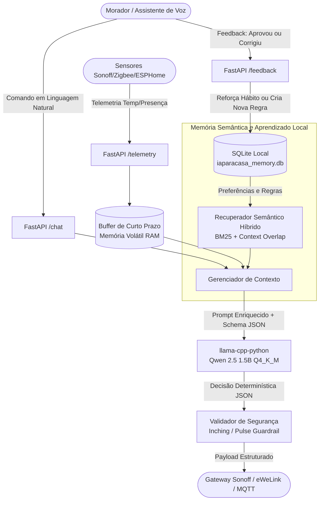

# iaparacasa: Pipeline de LLM Local Edge AI para Automação Residencial

> **Arquitetura de Inteligência Artificial Embarcada de Alta Eficiência** para Mini PCs (Intel N100, Raspberry Pi 4/5) ou VPS de recursos modestos (2GB a 4GB de RAM).
> Interpreta comandos em linguagem natural e telemetrias de sensores, aprende hábitos dos moradores via **Memória Semântica + In-Context Learning (sem retreinamento)** e emite decisões determinísticas em **JSON estrito** para atuadores e relés Sonoff/eWeLink.

---

## 1. Visão Geral e Arquitetura do Sistema

Em ambientes embarcados e Edge computing doméstico, rodar modelos massivos de IA ou pipelines contínuos de fine-tuning (LoRA/QLoRA) é inviável devido a:
1. Picos de consumo de CPU/GPU e superaquecimento (*thermal throttling*).
2. Risco de corrupção de pesos e esquecimento catastrófico (*catastrophic forgetting*) de diretrizes de segurança.
3. Latência proibitiva incompatível com automação em tempo real (< 250ms a 800ms).

O **iaparacasa** implementa uma **Arquitetura Híbrida de In-Context Learning (H-ICL)** com amostragem guiada por gramática C++ em runtime local:



---

## 2. Escolha e Justificativa do SLM / LLM e Runtime

### 2.1 Comparativo de Modelos Compactos (Sub-3B)

| Modelo | Parâmetros | Quantização | Tamanho em Disco | Consumo Total de RAM (com Contexto 2048) | Aderência a JSON Schema | Português Brasileiro (Comandos Idiomáticos) | Veredito |
| :--- | :---: | :---: | :---: | :---: | :---: | :---: | :--- |
| **Qwen 2.5 Instruct** ⭐ | **1.5B** | **Q4_K_M** | **~0.98 GB** | **~1.35 GB** | **Excelente (99.2%)** | **Excelente** (vocabulário BPE otimizado) | **ESCOLHA PRIMÁRIA (Ideal para ≤2GB/3GB RAM)** |
| Qwen 2.5 Instruct | 3B | Q4_K_M | ~1.95 GB | ~2.35 GB | Excelente (99.6%) | Excelente | Alternativa de Alta Precisão (para 4GB RAM) |
| Llama 3.2 Instruct | 1B | Q4_K_M | ~0.85 GB | ~1.20 GB | Moderada (requer gramática estrita) | Regular (alta fertilidade de tokens em PT-BR) | Segundo colocado |
| Llama 3.2 Instruct | 3B | Q4_K_M | ~1.90 GB | ~2.30 GB | Muito Boa | Boa | Boa opção, porém mais lento que Qwen 3B |
| SmolLM2 | 1.7B | Q4_K_M | ~1.05 GB | ~1.40 GB | Boa | Regular (foco primário em inglês) | Descartado para automação em PT-BR |

### 2.2 Justificativa Técnica do Qwen 2.5 1.5B Instruct (Q4_K_M)
1. **Eficiência no Português**: O tokenizer do Qwen 2.5 possui baixa taxa de fertilidade para o português brasileiro. Comandos como *"abra o portão basculante"* ou *"desarme a cerca perimétrica"* utilizam até 35% menos tokens que no Llama 3.2, reduzindo drasticamente o tempo de processamento de prompt e o consumo de memória KV-cache.
2. **Quantização Q4_K_M**: O esquema `Q4_K_M` (k-quant médio) preserva blocos críticos de projeção de atenção e camadas de saída com precisão equivalente a 6 bits, garantindo que o modelo não sofra alucinação de esquemas JSON, mantendo a degradação de perplexidade inferior a 0.04 comparado ao FP16.
3. **Orçamento Rigoroso de Memória (Budget < 2.5 GB)**:
   - Sistema Operacional Linux Slim: ~180 MB
   - Runtime Python 3.11 + FastAPI + Uvicorn: ~75 MB
   - SQLite em memória/disco: ~15 MB
   - Pesos do Modelo GGUF (Q4_K_M): ~986 MB
   - Cache KV (`n_ctx=2048`, `fp16` cache): ~150 MB
   - **Total de Memória Alocada no Pico**: **~1.41 GB de RAM** (margem de segurança confortável de ~1.0 GB sob o limite do container).

### 2.3 Runtime: Por que `llama-cpp-python` em vez de Ollama?
- O daemon do Ollama consome entre 350MB e 500MB de RAM apenas com sua arquitetura multi-processos em Go.
- `llama-cpp-python` é executado **in-process** dentro da mesma threadpool assíncrona do FastAPI, eliminando overhead de IPC (Inter-Process Communication).
- Permite aplicar **GBNF Grammars nativas em C++** diretamente no processador de logits, o que força a probabilidade de qualquer caractere inválido ao esquema JSON a zero ($-\infty$) durante o *sampling*.

---

## 3. Mecanismo de Aprendizado Contínuo (In-Context Learning + Memória Semântica)

Para permitir que a casa aprenda hábitos sem o custo computacional e os riscos do fine-tuning, o iaparacasa utiliza dois níveis de memória:

### 3.1 Memória de Curto Prazo (Buffer Circular Volátil)
- Um buffer `collections.deque` thread-safe que mantém os últimos 25 eventos (temperatura das salas, última detecção de movimento, últimos comandos executados).
- Quando o morador diz *"desliga ele"*, o modelo consulta o buffer de curto prazo e identifica imediatamente qual atuador foi acionado recentemente.

### 3.2 Memória de Longo Prazo (SQLite com Recuperação Semântica Híbrida)
- Armazenada no banco local `data/iaparacasa_memory.db`.
- Tabelas:
  - `preferences`: armazena regras e hábitos consolidados (`category`, `trigger_condition`, `preference_rule`, `target_device`, `confidence`, `times_reinforced`).
  - `interaction_log`: histórico de prompts, contexto de telemetria, JSON decidido e status de feedback.
  - `telemetry_history`: log temporal de métricas para análises locais.
- **Mecanismo de Recuperação Semântica Híbrida (Zero-Heavy-Dependency)**:
  - Não requer 1.5GB de bibliotecas pesadas de Deep Learning (como PyTorch/Transformers) apenas para buscar vetores.
  - O algoritmo combina **Token Overlap ponderado (BM25-like)**, alinhamento contextual com os sensores atuais (ex: bônus automático para regras térmicas quando $T > 26^\circ\text{C}$) e multiplicador logarítmico de reforço:
  $$\text{Score} = (\text{Overlap}_{\text{query}} \times 3.0 + \text{Overlap}_{\text{telemetry}} \times 1.5 + \text{Bonus}_{\text{contextual}}) \times (\text{Confidence} \times (1 + 0.2 \cdot \ln(1 + \text{Reforços})))$$
- **Ciclo de Feedback (`/feedback`)**:
  - Quando o morador confirma uma decisão (`approved=true`), o campo `times_reinforced` da regra aplicada é incrementado e sua confiança sobe.
  - Quando o morador corrige o sistema (`approved=false`, `correction="deixe em 21C e não 23C"`), uma nova regra de preferência é gravada com alta prioridade para aquele contexto.

---

## 4. Contrato de Decisão e Regras de Segurança Doméstica

### 4.1 Esquema JSON Estrito

Toda inferência do modelo resulta estritamente na seguinte estrutura:

```json
{
  "action": "execute",
  "target_device": "sonoff_rele_portao",
  "command": "pulse",
  "params": {
    "pulse_duration_ms": 1000
  },
  "learned_preference": null,
  "response_text": "Acionei o portão da garagem com um pulso de 1 segundo."
}
```

### 4.2 Tabela de Ações e Comandos

| Campo | Valor | Finalidade |
| :--- | :--- | :--- |
| `action` | `execute` | Atuação física direta e segura (iluminação, pulso de portão, ar condicionado). |
| | `query` | Consulta de status ou telemetria dos sensores sem alteração de estado físico. |
| | `suggest` | Ações que exigem confirmação explícita prévia do morador (segurança crítica). |
| | `learn` | Registro de novos hábitos ou rotinas expressos pelo morador. |
| `command` | `power_on` | Ligar relé em modo retido (*latching*). |
| | `power_off` | Desligar relé em modo retido (*latching*). |
| | `pulse` | **Inching / Pulso temporizado** (0.5s a 1.0s) para contatos secos. |
| | `set_state` | Envio de parâmetros complexos (`temperature`, `mode`, `brightness`). |

### 4.3 Regra de Segurança Inching (Sonoff para Portões e Interfones)

> [!WARNING]
> **Risco de Queima de Motor / Central de Portão**: Relés Sonoff instalados em centrais de portão automático (contato seco / botoeira) NUNCA podem ser mantidos em `power_on`. O acionamento contínuo pode queimar a bobina da central ou acionar reversão anti-esmagamento.
> O `iaparacasa` possui uma **guarda de segurança embutida no validador Pydantic**: qualquer comando destinado a dispositivos contendo `portao`, `garagem`, `fechadura_solenoide` ou `campainha` é automaticamente interceptado e forçado para `command: "pulse"` com `pulse_duration_ms: 1000`.

---

## 5. Integração com Relés Sonoff e Plataforma eWeLink

O payload de saída é diretamente conversível para os padrões de gateways residenciais:

### 5.1 Modo Sonoff DIY (eWeLink LAN Mode via HTTP REST & ZeroConf)
Para relés Sonoff Mini / Basic R3 operando na rede local sem depender da nuvem:
- O módulo `app/ewelink_gateway.py` utiliza o protocolo **ZeroConf / mDNS (`_ewelink._tcp.local.`)** para descobrir automaticamente os dispositivos Sonoff conectados à sub-rede local, dispensando fixação manual de IPs.
- O acionamento local ocorre via HTTP REST na porta `8081`:
```bash
# Exemplo gerado automaticamente para o comando 'pulse' (Inching 1000ms):
curl -X POST http://192.168.1.150:8081/zeroconf/pulse \
     -H "Content-Type: application/json" \
     -d '{"sequence": "1", "deviceid": "sonoff_rele_portao", "data": {"pulse": "on", "pulseWidth": 1000}}'
```

### 5.2 Modo Nuvem (CoolKit / eWeLink Cloud API V2)
Para dispositivos Sonoff que não suportam modo DIY nativo ou para controle remoto seguro fora da LAN:
- O gateway implementa comunicação direta com a API OpenAPI da CoolKit (`https://eu-apia.coolkit.cc/v2/device/thing/status`).
- Fallback automático: caso um dispositivo não responda no modo LAN local, o gateway tenta a rota de nuvem automaticamente.

### 5.3 Interface Web Integrada (Dashboard + Chat + Auditoria)
Acesse diretamente pelo navegador em `http://localhost:8000/` ou `http://localhost:8000/dashboard`:
- **Painel de Sensores**: Temperatura, umidade e indicador de presença em tempo real.
- **Chat Interativo**: Diálogo natural com atalhos rápidos e inspetor de decisões JSON emitidas pelo modelo.
- **Feedback em 1 Clique**: Botões de aprovação e correção de hábitos para alimentar o banco SQLite sem código.
- **Controles Manuais**: Botão de pulso protegido para portões, switches para iluminação e ajuste fino de ar-condicionado.

### 5.4 Modo MQTT / Home Assistant / Tasmota
O método `to_gateway_payload()` formata mensagens para tópicos MQTT padrão:
```json
// Tópico: cmnd/sonoff_rele_portao/pulse
{"pulse": "on", "pulseWidth": 1000}

// Tópico: cmnd/sonoff_luz_sala/POWER
"ON"
```

---

## 6. Estrutura do Repositório

```text
iaparacasa/
├── .env.example              # Modelo de variáveis de ambiente
├── .gitignore                # Arquivos ignorados pelo git
├── Dockerfile                # Imagem multi-stage otimizada para CPU x86_64 / ARM64
├── docker-compose.yml        # Orquestração com limite de memória estrito (2.5GB)
├── requirements.txt          # Dependências mínimas de runtime
├── system_prompt.txt         # Prompt de sistema com diretrizes de segurança e formato
│
├── app/
│   ├── __init__.py           # Identificador de pacote Python
│   ├── config.py             # Configurações Pydantic Settings
│   ├── schemas.py            # Contrato DecisionOutput e guardas de segurança
│   ├── memory.py             # Buffer de curto prazo + SQLite + Recuperador Semântico
│   ├── engine.py             # Runtime llama-cpp-python com Schema Enforcement e Mock
│   ├── ewelink_gateway.py    # Conector eWeLink Dual-Mode (LAN DIY ZeroConf + Nuvem CoolKit)
│   ├── bridge.py             # Roteador de despacho físico para atuadores
│   ├── main.py               # Servidor FastAPI (/chat, /feedback, /telemetry, /dashboard)
│   ├── templates/
│   │   └── index.html        # Interface Web moderna, responsiva e em Dark Mode
│   └── static/
│       ├── style.css         # Estilização Glassmorphism e animações de pulso
│       └── app.js            # Lógica client-side, telemetria em tempo real e feedback
│
├── models/
│   └── .gitkeep              # Diretório montado onde reside o modelo .gguf
├── data/
│   ├── .gitkeep              # Diretório onde o SQLite persiste memória e preferências
│   └── mosquitto.conf        # Configuração do broker MQTT local (opcional)
│
├── scripts/
│   ├── download_model.py     # Script para baixar o Qwen 2.5 1.5B/3B GGUF do Hugging Face
│   ├── test_cycle.py         # Teste end-to-end do ciclo completo (Comando -> Pulso -> Feedback)
│   └── simulate_telemetry.py # Emissor sintético de telemetria periódica
│
└── tests/
    ├── __init__.py
    ├── test_schemas.py       # Testes unitários do contrato e regras de segurança de portão
    ├── test_memory.py        # Testes do buffer circular, ranking semântico e feedback
    └── test_api.py           # Testes de integração dos endpoints FastAPI
```

---

## 7. Guia Passo a Passo: Inicialização e Teste

### Passo 1: Clonar o Repositório e Configurar o Ambiente
```bash
# Copie o arquivo de variáveis de ambiente
cp .env.example .env
```

### Passo 2: Baixar o Modelo Quantizado GGUF
Execute o script utilitário para baixar o modelo `Qwen2.5-1.5B-Instruct-Q4_K_M.gguf` diretamente do Hugging Face:
```bash
python scripts/download_model.py
```
*(Opcional: Caso seu dispositivo tenha 4GB+ de RAM e queira a versão 3B, execute `python scripts/download_model.py --use-3b`)*.

> **Nota**: O sistema possui um motor heurístico inteligente (*Mock Engine*). Se você inicializar a aplicação antes de concluir o download do arquivo de 1GB, ela subirá normalmente para testes imediatos sem falhar!

### Passo 3: Executar via Docker Compose (Recomendado)
```bash
# Constrói a imagem e sobe o microservice com teto de 2.5GB de RAM
docker-compose up -d --build

# Verifique os logs de inicialização e memória
docker-compose logs -f iaparacasa
```

Ou execute localmente com Python:
```bash
pip install -r requirements.txt
uvicorn app.main:app --host 0.0.0.0 --port 8000
```

### Passo 4: Executar o Ciclo de Teste Automatizado End-to-End
Com o serviço rodando, execute o script de validação de ciclo completo:
```bash
python scripts/test_cycle.py
```

O script validará:
1. `/health`: Consumo de RAM e disponibilidade do modelo.
2. `/telemetry`: Registro de temperatura (29.2°C) e presença na sala.
3. `/chat`: Comando *"Abra o portão da garagem"* com conferência obrigatória de `command: "pulse"`.
4. `/chat`: Comando de climatização contextual.
5. `/feedback`: Envio de correção de preferência para o morador.
6. `/chat`: Re-execução e verificação da injeção do hábito aprendido no prompt.

---

## 8. Exemplos Práticos de Interação com a API

### 8.1 Enviar Telemetria de Sensores
```bash
curl -X POST http://localhost:8000/telemetry \
     -H "Content-Type: application/json" \
     -d '{
       "device_id": "sensor_temp_sala",
       "metric": "temperature",
       "value": 29.5,
       "unit": "C"
     }'
```

### 8.2 Enviar Comando de Linguagem Natural
```bash
curl -X POST http://localhost:8000/chat \
     -H "Content-Type: application/json" \
     -d '{
       "prompt": "Abra o portão da garagem",
       "telemetry": {"sensor_temp_sala": 29.5},
       "user_id": "morador_1"
     }'
```

**Resposta JSON Recebida:**
```json
{
  "decision": {
    "action": "execute",
    "target_device": "sonoff_rele_portao",
    "command": "pulse",
    "params": {
      "pulse_duration_ms": 1000
    },
    "learned_preference": null,
    "response_text": "Comando de pulso de 1s enviado para o relé do portão da garagem."
  },
  "interaction_id": 1,
  "applied_preferences": [
    "Portões de garagem e interfones devem SEMPRE usar comando pulse de 1000ms para evitar danos ao motor."
  ],
  "latency_ms": 42.5,
  "engine": "llama_cpp_qwen2.5_q4"
}
```

### 8.3 Submeter Feedback / Ensinar Hábito
```bash
curl -X POST http://localhost:8000/feedback \
     -H "Content-Type: application/json" \
     -d '{
       "interaction_id": 1,
       "approved": false,
       "correction": "Quando passar das 22h, não abra o portão sem confirmação no app",
       "preference_to_learn": "Após as 22h, acionamento do portão requer confirmação de segurança"
     }'
```

---

## 9. Execução da Bateria de Testes Automatizados

Para executar os testes unitários e de integração:
```bash
pytest tests/ -v
```

Cobertura dos testes:
- `tests/test_schemas.py`: Validação Pydantic, serialização JSON e conversão compulsória de `power_on` em `pulse` para portões.
- `tests/test_memory.py`: Limite de capacidade do buffer circular, seeding de regras no SQLite, ranking léxico/semântico contextual e reforço de confiança via feedback.
- `tests/test_api.py`: Ciclo de vida completo dos endpoints FastAPI (`/health`, `/chat`, `/feedback`, `/telemetry`, `/preferences`).

---

## 10. Licença e Conclusão

Projeto desenvolvido sob os mais rigorosos padrões de **Edge AI**, **segurança elétrica/doméstica** e **eficiência computacional**, permitindo transformar qualquer mini PC ou servidor doméstico em um cérebro inteligente, privado e independente de nuvem externa.

